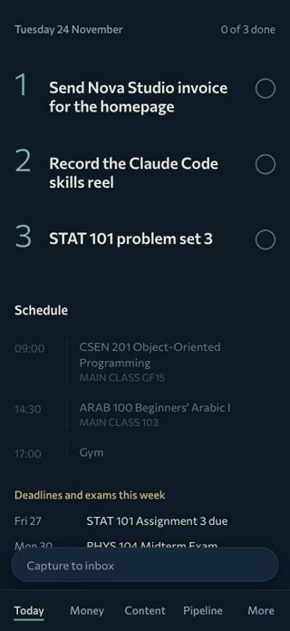
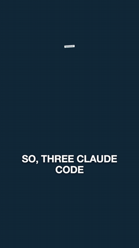
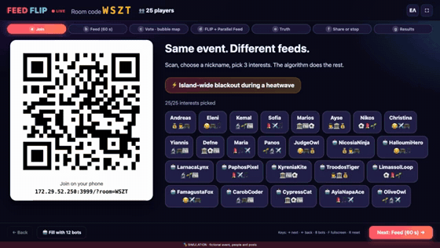
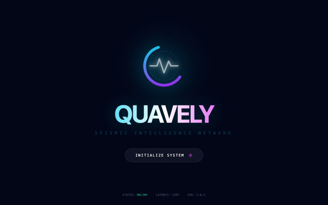
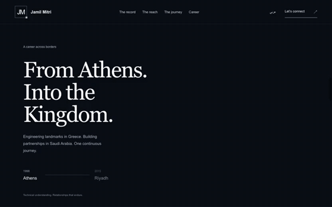

I design and ship apps, client websites and the tools behind my own content. Computer Science and Engineering student at AUB Mediterraneo, building in Paphos, Cyprus.

| **300K+** | **8** | **8** |
|:--|:--|:--|
| followers grown from zero | client websites built | apps built, solo and in teams |

## Featured work

<table>
<tr>
<td width="50%" valign="top">
 
<b>Command Center</b> 
One private app for my day, money, content and clients. Bank sync, CSV import with auto-categorising, a posting calendar and a weekly review that writes itself. 
Next.js, Supabase, Vercel
</td>
<td width="50%" valign="top">
 
<b>Auto Editor</b> 
I record, it delivers the reel. Local Whisper transcription, automatic cuts for filler and restarts, face-tracked 9:16 reframe, animated captions and -14 LUFS audio. 
Remotion, FFmpeg, whisper.cpp, Claude
</td>
</tr>
<tr>
<td width="50%" valign="top">
 
<b>FEED FLIP Schools</b> 
A live classroom game that trains students to spot AI-era scams and filter bubbles. Pitched at the British Council Youth Connect "Media Literacy in the Age of AI" competition, Nicosia 2026. 
Node.js, WebSockets, English and Greek
</td>
<td width="50%" valign="top">
 
<b>Quavely</b> &nbsp;<a href="https://quavely.netlify.app">Live app</a> 
A seismic safety app for our university, built with Loukas D. Louka. 
PWA, JavaScript
</td>
</tr>
<tr>
<td colspan="2" valign="top">
 
<b>Client websites</b> 
Fast, bilingual sites for professionals and local businesses in Greece and Cyprus, designed and built end to end. <a href="mailto:georgiosmitri999@gmail.com?subject=Website%20project">Want one? Email me.</a>
</td>
</tr>
</table>

## Currently building

<!-- CURRENTLY:START -->
- **Command Center**: connecting bank sync and the iCloud calendar
- **Auto Editor**: tuning cuts and captions on real iPhone footage
<!-- CURRENTLY:END -->

## Latest videos

<!-- VIDEOS:START -->
New Reels and Shorts appear here automatically. Until then, they are on [Instagram @george._.mitri](https://instagram.com/george._.mitri).
<!-- VIDEOS:END -->

## Stack

## Contact

**[Hire me for a website](mailto:georgiosmitri999@gmail.com?subject=Website%20project)** &emsp; [Email](mailto:georgiosmitri999@gmail.com) &emsp; [Instagram](https://instagram.com/george._.mitri)
